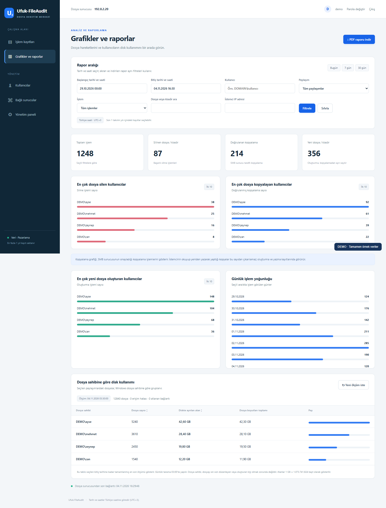
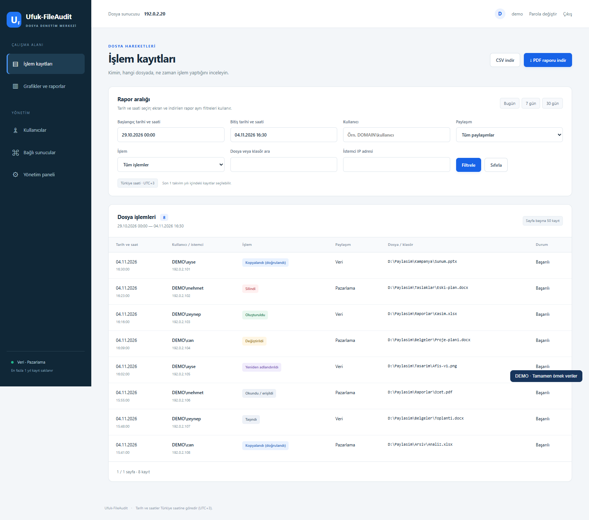
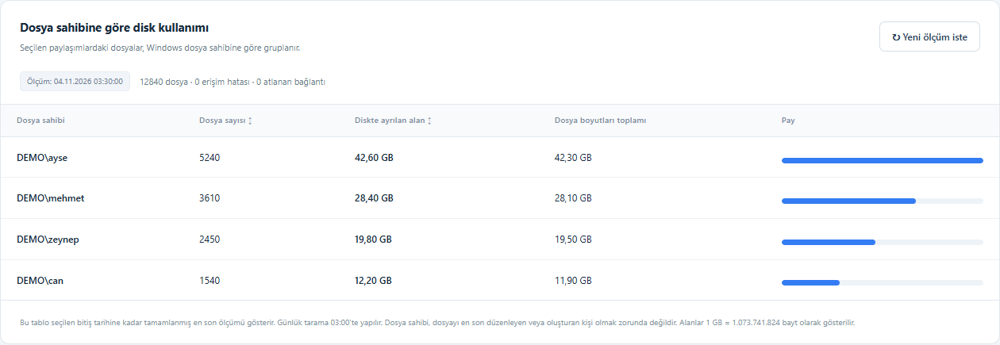
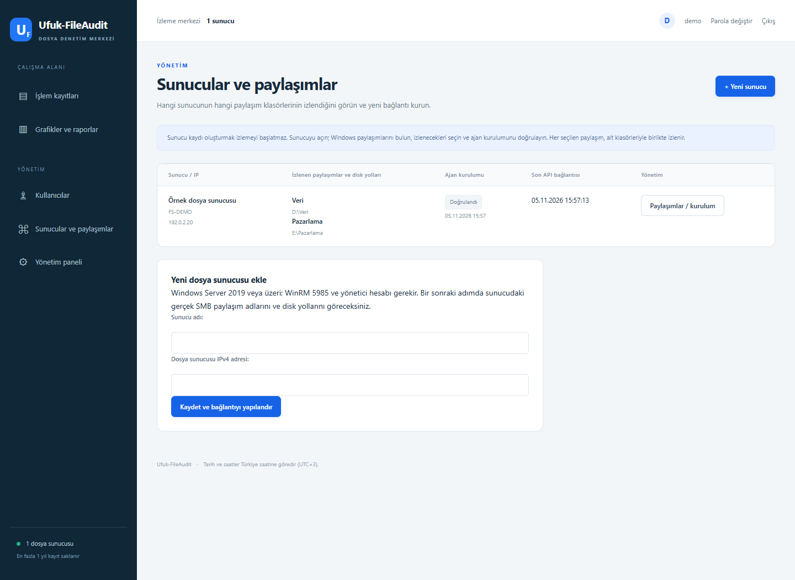
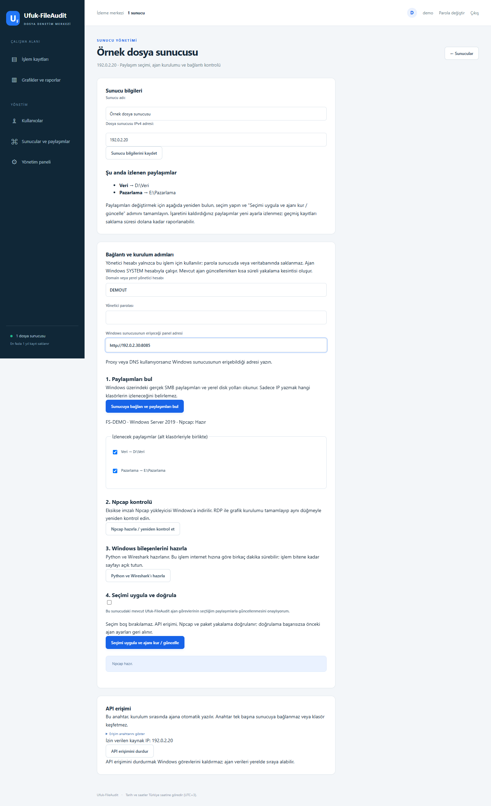

# Ufuk-FileAudit

[Türkçe](README.md) · **English installation guide**

File auditing and reporting for Windows file servers. The web application runs on Ubuntu in Docker. The SMB auditing agent and disk inventory worker run on Windows as SYSTEM.

## Screenshots

Captured from the actual application interface using entirely fictional demo data. Users, files, IP addresses and measurements are examples. The application interface is in Turkish.

### Charts and reports



### Audit log



### Disk usage by file owner



## Manage servers and shares in the panel (1.1.0)

Open **Yönetim → Sunucular ve paylaşımlar** (Administration → Servers and shares). Each record shows its IPv4 address, selected SMB shares, local Windows paths, installation verification and last API contact.





1. Register a name and the server's real IPv4 address. Registration alone does not start monitoring.
2. Open the record and enter a `DOMAIN\\user` or `SERVER\\user` administrator account, password and the panel URL reachable from Windows. WinRM port 5985 must be reachable. Administrator passwords are not stored; use HTTPS for the management page.
3. Discover shares from Windows, then select the actual share names and local paths to monitor. Selected shares include their subfolders. Create an SMB share in Windows first if the local folder is not shared.
4. Check Npcap. If missing, complete its graphical installer through RDP and check again. Prepare Python and Wireshark using the next button.
5. Apply the selection and install/update the agent. Existing tasks require the explicit replacement checkbox. SYSTEM tasks, API access, Npcap and capture are verified. Updating briefly interrupts capture; a verification failure restores previous tasks.

To add or remove monitored shares later, reopen the same record and repeat discovery, selection and deployment. Historical logs remain until their one-year retention expires. Disabling API access does not uninstall Windows tasks.

Logs and charts have a server filter. Combined disk reports sum each selected server's latest completed measurement before the report end, with individual measurement timestamps. Scan requests are isolated per server.

When upgrading a 1.0.0 installation with 1.1.0 source, preserve `runtime.env`, `.env` and `data`, then run `sudo bash update.sh` from the installation directory. It backs up the database before migration. Existing primary-server logs are associated automatically. Older installations without stored disk paths need one discovery/update from the panel to verify those paths.

## Install from GitHub

Clone the source repository:

```bash
git clone https://github.com/ufodepocum/Ufuk-FileAudit.git
cd Ufuk-FileAudit
sudo bash install.sh
```

If release assets have been published, use the standalone installer:

```bash
curl -fL https://github.com/ufodepocum/Ufuk-FileAudit/releases/latest/download/install.sh -o install.sh
sudo bash install.sh --source https://github.com/ufodepocum/Ufuk-FileAudit/releases/latest/download/
```

This repository and its release assets are public, so installation does not require a GitHub account.

`--source` is a download base URL, not a browsable directory. Opening that URL alone may return GitHub's 404 page. The installer appends `SHA256SUMS` and `Ufuk-FileAudit-1.1.0.tar.gz` to download the files. Do not use the repository homepage as `--source`.

To browse downloads, open **Assets** on the [latest release page](https://github.com/ufodepocum/Ufuk-FileAudit/releases/latest). The [installer script](https://github.com/ufodepocum/Ufuk-FileAudit/releases/latest/download/install.sh) and [checksum file](https://github.com/ufodepocum/Ufuk-FileAudit/releases/latest/download/SHA256SUMS) are direct downloads.

Copy the two commands from the code block in order, without adding HTML entities, backslashes or Markdown link syntax.

## Host the installer on any website

Extract `Ufuk-FileAudit-Web-Yayin-Paketi.zip` and upload the **contents** of its `Ufuk-FileAudit-Web` folder to any directory on a web server that serves static files.

Keep these files together:

- `install.sh`
- `SHA256SUMS`
- `Ufuk-FileAudit-1.1.0.tar.gz`

The package also includes a source-code browser, download page, ZIP archive and a static HTTP Git repository. PHP and a website database are not required.

On the new Ubuntu server:

```bash
curl -fL https://YOUR-SITE/YOUR-FOLDER/install.sh -o install.sh
sudo bash install.sh --source https://YOUR-SITE/YOUR-FOLDER/
```

There is no fixed domain. The `--source` URL identifies the folder containing the release files. If it is omitted and local source files are absent, the installer asks for the URL.

Download and verify the source without installing:

```bash
bash install.sh --source https://YOUR-SITE/YOUR-FOLDER/ --download-only --target ./Ufuk-FileAudit-source
```

## Install an extracted archive

```bash
tar -xzf Ufuk-FileAudit-1.1.0.tar.gz
cd Ufuk-FileAudit-1.1.0
sudo bash install.sh
```

The default installation directory is `/opt/ufuk-fileaudit`. Use `--target` to select another dedicated directory.
To display the installation plan without changing the system, run `bash install.sh --plan`.

## Requirements

- Ubuntu 22.04 LTS or 24.04 LTS, 64-bit, with Docker Compose 2.30 or later.
- Windows Server 2019 or later, 64-bit.
- Administrative WinRM access from Ubuntu to Windows on TCP 5985. The installer uses NTLM with message encryption.
- Connectivity from Windows to the Ubuntu web/API port, normally TCP 8085.
- Internet access on both servers to download dependencies.

If WinRM is disabled, prepare Windows in an elevated PowerShell session with `Enable-PSRemoting -Force`. The chosen domain or local administrator account must have remote administrative access. The installer does not weaken UAC or network security policies automatically.

## Installation prompts

The current installer prompts are in Turkish. It asks for:

1. The Windows file server's actual IPv4 address.
2. A domain account such as `DOMAIN\Administrator`, or a local account such as `SERVER\Administrator`.
3. The administrator password, entered with hidden input. It is not saved to disk or scheduled tasks.
4. Share names selected from the real shares retrieved from Windows.
5. The Ubuntu IPv4 address reachable from Windows and the web port.

The wizard checks access, waits for Npcap if required, installs the web application and Windows dependencies, starts the two SYSTEM tasks, then verifies the API and packet capture process.
An existing agent requires explicit migration confirmation. An unrelated installation directory or another Ubuntu deployment is not overwritten silently.

## Npcap step

Npcap must be installed on the **Windows file server**, not Ubuntu.

If the driver is missing, the wizard downloads and verifies the signature of the official installer at:

```text
C:\ProgramData\Ufuk-FileAudit\downloads\npcap-1.90.exe
```

Connect to Windows using RDP and run that file with the default options. Return to the Ubuntu terminal and press Enter. The wizard checks the service and DLLs again and will not continue until they are ready.

The free Npcap installer requires the graphical step. Silent installation is an Npcap OEM feature; no OEM license or installer is included.
Official reference: https://npcap.com/guide/npcap-users-guide.html

## First web login

```text
URL:      http://UBUNTU-IP:8085/
Username: admin
Password: admin
```

The first login requires a password change. Existing account passwords are preserved on subsequent installations and restarts.
The distributed source package contains no existing users, audit records, administrator passwords or production secret keys.

## Reporting and retention

- Turkish web interface with date/time filters in Turkey time, UTC+3.
- PDF and CSV exports include all matching records, not just the currently displayed page.
- Creation, modification, access, rename, move, deletion and confirmed SMB server-side copy events.
- User rankings, activity charts and ownership-based disk usage.
- Initial inventory scan followed by daily scans at 03:00 and an on-demand scan request.
- A maximum of one calendar year of audit records and inventory snapshots, cleaned hourly.

Confirmed copy counts cover SMB COPYCHUNK operations acknowledged by the server. A client reading a file and writing another one cannot reliably be classified as a copy; it appears as creation/write activity.
Encrypted SMB traffic and operations performed locally on the file server are not guaranteed to be captured by this method.
Disk usage is grouped by Windows file owner. Ownership does not necessarily identify the creator or last editor. Reports use the latest completed measurement before the selected end time; historical usage cannot be reconstructed before the first measurement. Measurement/access errors are disclosed in the report. Sizes use 1 GB = 1,073,741,824 bytes.

## Maintenance and removal

```bash
cd /opt/ufuk-fileaudit
sudo bash status.sh
sudo docker compose logs --tail 100
sudo bash update.sh
sudo bash uninstall.sh
```

Updates back up SQLite first. Local backups are kept for seven days.
Uninstallation preserves the database and configuration. To remove the entire installation directory, use `sudo bash uninstall.sh --purge` and confirm with `SIL`.

In elevated Windows PowerShell:

```powershell
powershell -NoProfile -ExecutionPolicy Bypass -File C:\ProgramData\Ufuk-FileAudit\uninstall.ps1
```

Add `-Purge` to remove the Windows installation folder as well. Shared Npcap software is not removed automatically. User files and share permissions are not changed.

## Source and testing

`app/` contains the web application, `agent/` contains the Windows workers, and `installer/` contains the wizard and PowerShell stages. Dependencies are version-pinned. After committing changes, rebuild the static publication package with:

```bash
python3 tools/release.py --out ../ready-to-publish
```

Installer tests, web integration tests, a clean-database first-login/password-change HTTP test, PDF downloads, archive checksums, source browsing and static HTTP Git cloning have been checked. Windows stages have syntax and simulated-flow tests; the distribution installer has not been executed end-to-end in a separate clean Windows VM. See `TESTING.md`.

## License

 The GPL-3.0 license and upstream attribution are included in `LICENSE` and `NOTICE`. Windows installers for Python, Wireshark and Npcap are downloaded from official sources on the target machine and are not bundled here.
