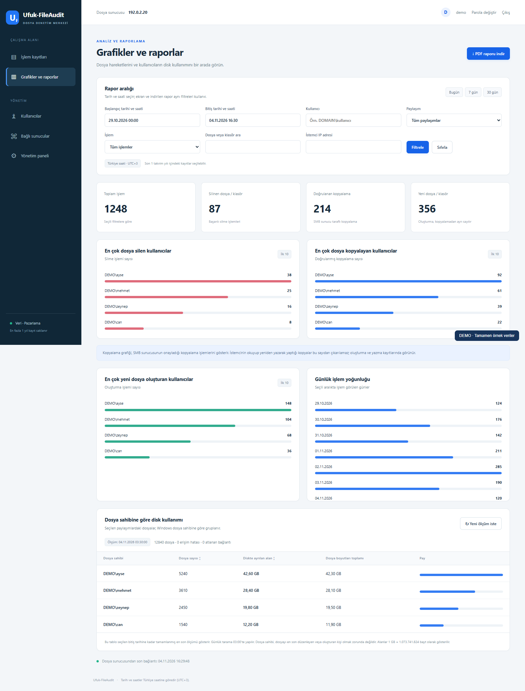
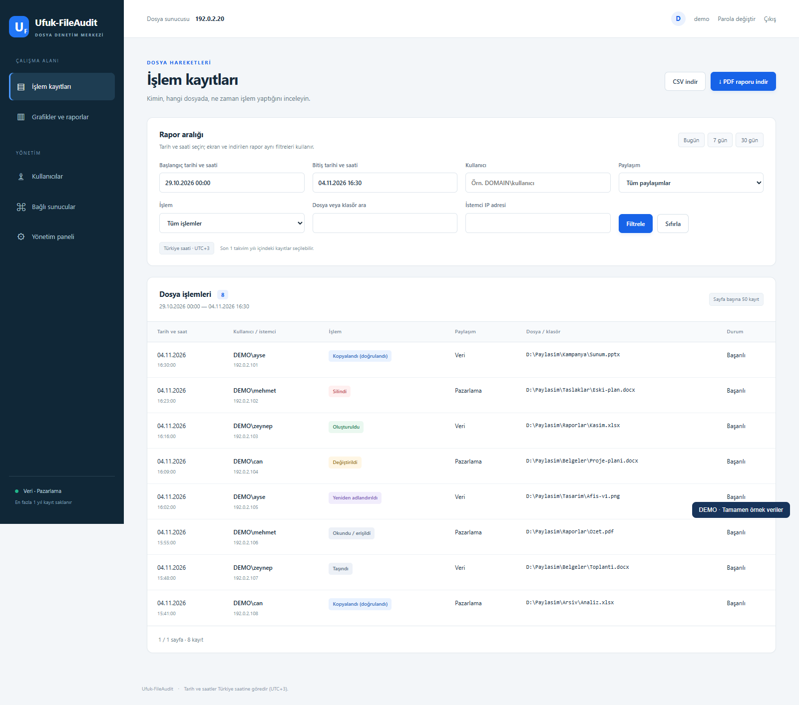
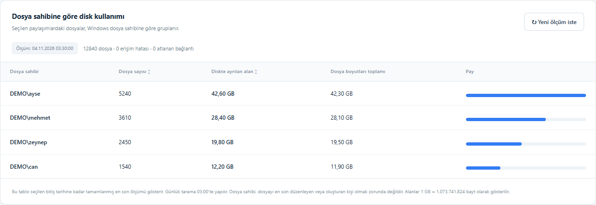
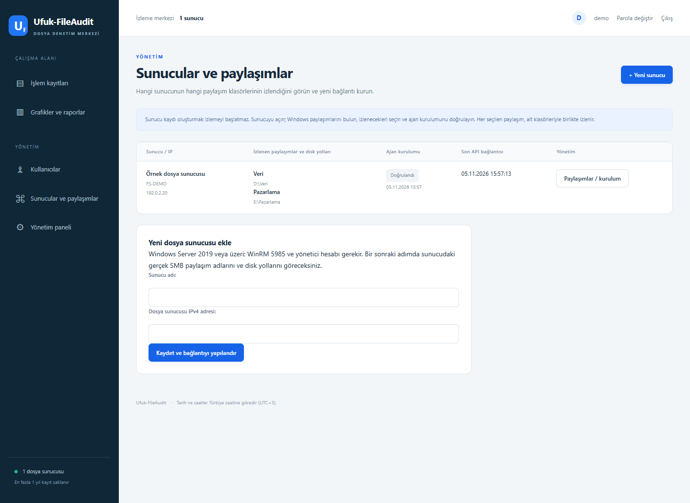
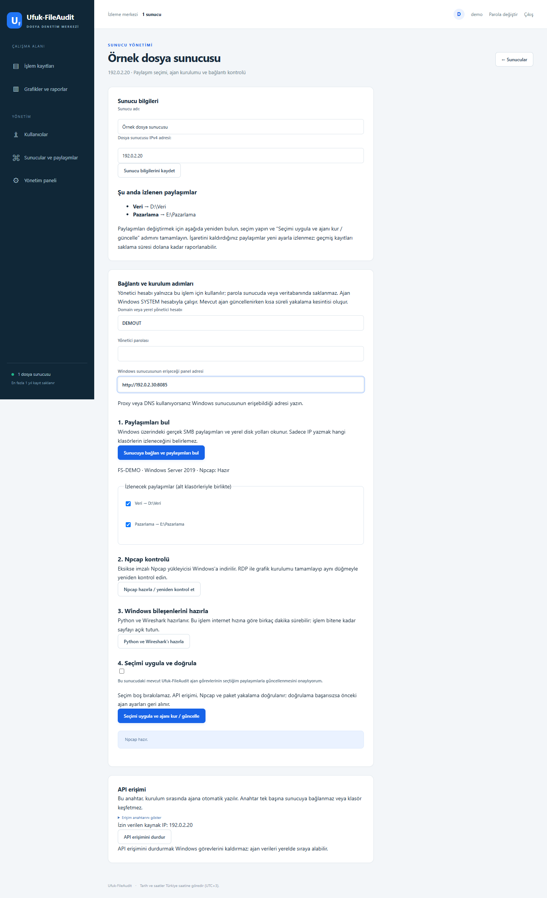

# Ufuk-FileAudit

**Türkçe** · [English installation guide](README.en.md)

Windows dosya sunucuları için Türkçe denetim, grafik ve PDF raporlama uygulaması.
Web uygulaması Ubuntu'da Docker ile; SMB ajanı ve disk envanteri Windows'ta SYSTEM hesabıyla çalışır.

## Örnek ekran görüntüleri

Görseller gerçek uygulama arayüzünden, tamamen kurgusal demo verileriyle hazırlanmıştır. Kullanıcılar, dosyalar, IP adresleri ve ölçümler örnektir.

### Grafikler ve raporlar



### İşlem kayıtları



### Dosya sahibine göre disk kullanımı



## Panelden sunucu ve paylaşım yönetimi (1.1.0)

**1.1.1 düzeltmesi:** Paylaşım güncellemesinde eksik ayrıştırıcı dosyası ve mevcut Wireshark kurulumunun yeniden kullanımı düzeltildi. Çalışan ajan durdurulmadan önce dosyalar ve Python modülleri kontrol edilir; hata oluşursa aşama ve güvenli hata kodu gösterilir.

**Yönetim → Sunucular ve paylaşımlar** bölümünde her sunucunun IP adresi, seçilen SMB paylaşımları, Windows disk yolları, kurulum doğrulaması ve son API bağlantısı görünür.





1. **Yeni sunucu** ile adını ve gerçek IPv4 adresini kaydedin. Bu adım tek başına izlemeyi başlatmaz.
2. Sunucuyu açın; `DOMAIN\\kullanıcı` veya `SUNUCU\\kullanıcı` yönetici hesabını, parolasını ve Windows'un erişebileceği panel adresini girin. WinRM 5985 erişimi gerekir. Yönetici parolası saklanmaz; yönetim sayfasına HTTPS üzerinden erişmeniz önerilir.
3. **Sunucuya bağlan ve paylaşımları bul** düğmesi, Windows'tan gerçek SMB paylaşım adlarını ve yerel disk yollarını okur. İzlenecekleri işaretleyin. Seçilen paylaşımlar alt klasörleriyle birlikte izlenir; paylaşılmamış bir yerel klasörü önce Windows'ta paylaşmanız gerekir.
4. Npcap kontrolünü tamamlayın; eksikse Windows'ta gösterilen yükleyiciyi RDP ile açıp kurun, sonra tekrar kontrol edin. Python ve Wireshark hazırlama adımını çalıştırın.
5. **Seçimi uygula ve ajanı kur / güncelle** ile SYSTEM görevleri hazırlanır ve API/Npcap/yakalama doğrulanır. Mevcut görevleri değiştirmek için onay kutusunu seçin. Kurulum sırasında kısa bir yakalama kesintisi olur; doğrulama başarısızsa önceki görevler geri alınır.

Sonradan paylaşım eklemek veya çıkarmak için aynı sunucuyu açıp keşif/seçim/uygulama adımlarını tekrarlayın. Tarihçe kayıtları bir yıllık saklama süresi boyunca korunur. **API erişimini durdur** Windows görevlerini kaldırmaz.

Log ve grafik ekranlarında **Dosya sunucusu** filtresi vardır. Birleşik disk raporu, seçili her sunucunun rapor bitişinden önceki en son ölçümünü toplar; ölçüm tarihleri ayrı gösterilir. Ölçüm istekleri yalnızca ilgili sunucuya gönderilir.

Mevcut 1.0.0 kurulumunu 1.1.0 kaynaklarıyla güncellerken `runtime.env`, `.env` ve `data` klasörünü koruyun, ardından kurulum dizininde `sudo bash update.sh` çalıştırın. Betik önce veritabanını yedekler. İlk kurulum sunucusu ve mevcut kayıtlar otomatik ilişkilendirilir; eski kurulumda disk yolları kaydedilmemişse panelde bir kez paylaşım keşfi/güncellemesi yapın.

## GitHub'dan kurulum

Kaynak deposunu klonlayarak:

```bash
git clone https://github.com/ufodepocum/Ufuk-FileAudit.git
cd Ufuk-FileAudit
sudo bash install.sh
```

GitHub Releases bölümüne kurulum dosyaları yüklendiyse tek betikle:

```bash
curl -fL https://github.com/ufodepocum/Ufuk-FileAudit/releases/latest/download/install.sh -o install.sh
sudo bash install.sh --source https://github.com/ufodepocum/Ufuk-FileAudit/releases/latest/download/
```

`--source` bir indirme taban adresidir; tarayıcıda açılacak dosya listesi değildir. Bu adresi tek başına açınca GitHub 404 gösterebilir. Kurucu adresin sonuna `SHA256SUMS` ve `Ufuk-FileAudit-1.1.1.tar.gz` ekleyerek dosyaları indirir. Depo ana sayfasının adresini `--source` olarak kullanmayın.

Dosyaları tarayıcıdan görmek için [Sürümler / Releases](https://github.com/ufodepocum/Ufuk-FileAudit/releases/latest) sayfasındaki **Assets** bölümünü açın. [Kurulum betiği](https://github.com/ufodepocum/Ufuk-FileAudit/releases/latest/download/install.sh) ve [SHA256 doğrulama dosyası](https://github.com/ufodepocum/Ufuk-FileAudit/releases/latest/download/SHA256SUMS) doğrudan indirilebilir.

Yukarıdaki kod bloğundaki iki komutu sırayla kopyalayın; komutlara `&#x20;`, ters eğik çizgi veya Markdown bağlantı işaretleri eklemeyin.


## Web sitenizden kurulum

Yayın paketindeki dosyaları web sitenizin **herhangi bir klasörüne** açın. PHP, veritabanı veya özel Git sunucusu gerekmez.
`install.sh`, `SHA256SUMS` ve `Ufuk-FileAudit-1.1.1.tar.gz` aynı web klasöründe bulunmalıdır.

Yeni Ubuntu sunucusunda, adresi kendi yüklediğiniz klasörle değiştirin:

```bash
curl -fL https://SITENIZ/KLASOR/install.sh -o install.sh
sudo bash install.sh --source https://SITENIZ/KLASOR/
```

Sabit alan adı yoktur. `--source` verilmez ve yerel kaynaklar bulunamazsa kurucu web klasörü adresini sorar.
Kodu çalıştırmadan yalnızca indirmek için:

```bash
bash install.sh --source https://SITENIZ/KLASOR/ --download-only --target ./Ufuk-FileAudit-kaynak
```

## Elle indirilen kaynakla kurulum

```bash
tar -xzf Ufuk-FileAudit-1.1.1.tar.gz
cd Ufuk-FileAudit-1.1.0
sudo bash install.sh
```

Varsayılan kurulum dizini `/opt/ufuk-fileaudit` olur. `--target` ile ayrı bir kurulum dizini seçebilirsiniz.
Kurucuyu değişiklik yapmadan incelemek için `bash install.sh --plan` komutunu kullanın.

## Sihirbazın sorduğu bilgiler

1. Dosya sunucusunun gerçek IPv4 adresi.
2. `DOMAIN\kullanıcı` veya `SUNUCU\kullanıcı` biçiminde domain/yerel yönetici hesabı.
3. Gizli girilen yönetici parolası. Parola dosyaya veya Windows görevine yazılmaz.
4. Windows'tan listelenen gerçek paylaşımlar arasından izlenecek paylaşım adları.
5. Windows sunucusunun erişebileceği Ubuntu IPv4 adresi ve web portu; varsayılan port 8085.

Sihirbaz bağlantıyı, Npcap'i, gerekli Windows bileşenlerini, web uygulamasını ve iki SYSTEM görevini kurar/doğrular.
Mevcut bir Ufuk-FileAudit ajanı bulunursa taşımayı açıkça sorar. Başka klasörde çalışan bir Ubuntu kurulumu varsa üzerine yazmaz.

## Npcap adımı

Npcap **Windows dosya sunucusuna** kurulur; Ubuntu'ya kurulmaz.
Sürücü yoksa kurucu, imzasını kontrol ettiği resmi Npcap dosyasını Windows sunucusuna indirir:

```text
C:\ProgramData\Ufuk-FileAudit\downloads\npcap-1.90.exe
```

Windows'a RDP ile bağlanıp dosyayı varsayılan seçeneklerle kurun. Ubuntu terminalinde Enter'a basın.
Kurucu servisi ve DLL'leri yeniden kontrol eder; gerçekten hazır değilse sonraki adıma geçmez.
Ücretsiz sürümün sessiz kurulumu yoktur; bu özellik Npcap OEM içindir. OEM yükleyicisi veya lisansı bu depoya dahil değildir.

Resmi açıklama: https://npcap.com/guide/npcap-users-guide.html

## İlk giriş

```text
Adres: http://UBUNTU-IP:8085/
Kullanıcı: admin
Parola: admin
```

İlk girişte parola değiştirme ekranı açılır. Mevcut bir hesabın parolası yeniden kurulumda veya yeniden başlatmada sıfırlanmaz.
Yeni kurulum temiz bir veritabanıyla başlar; bu dağıtım mevcut ortamınızın loglarını, kullanıcılarını ve gizli anahtarlarını içermez.

## Gereksinimler

- Ubuntu 22.04 LTS veya 24.04 LTS, 64 bit; Docker Compose 2.30+.
- Windows Server 2019 veya daha yeni, 64 bit.
- Ubuntu'dan Windows'a WinRM TCP 5985 ve yönetici erişimi. NTLM oturumunun mesajları şifrelenir.
- Windows'tan Ubuntu'nun web/API portuna erişim.
- Bileşenleri indirmek için iki sunucuda da internet erişimi.
- İlk disk taraması dosya sayısına bağlı olarak zaman alır; arayüz bu sırada çalışmaya devam eder.

Windows'ta WinRM kapalıysa Windows yönetici PowerShell oturumunda `Enable-PSRemoting -Force` ile hazırlayın.
Kurucu WinRM/UAC veya ağ güvenlik politikalarını kendi başına gevşetmez. Yerel hesabın uzak yönetici erişimi olmalıdır.

## Özellikler

- Türkçe arayüz ve Türkiye saatine göre tarih/saat filtreleri.
- Filtreye uyan **tüm** logları, sadece görünen sayfayla sınırlamadan PDF/CSV indirme.
- Silme, oluşturma, okuma, değiştirme, taşıma, yeniden adlandırma ve doğrulanmış SMB kopyalama kayıtları.
- En çok silen/kopyalayan/oluşturan kullanıcılar ve günlük işlem grafikleri.
- Windows dosya sahibine göre dosya sayısı, dosya boyutu ve diskte ayrılan alan.
- Günlük 03:00 envanter ölçümü ve arayüzden yeni ölçüm isteği.
- Loglar ve envanter ölçümleri için en fazla bir takvim yılı; saatlik otomatik temizlik.

Kopyalama grafiği sunucunun onayladığı SMB COPYCHUNK işlemlerini sayar. İstemcinin dosyayı okuyup yeniden yazarak yaptığı kopyalar doğrudan kopya olarak ayırt edilemez; oluşturma/yazma kayıtlarında görünür.
SMB şifreli trafik ve sunucunun yerel diski üzerinden yapılan işlemler bu paket yakalama yöntemiyle garanti edilmez.
Disk raporu dosya sahibine dayanır; sahibi, oluşturan veya son düzenleyen kişiyle aynı olmayabilir. Rapor bitiş tarihinden önce tamamlanan en son ölçüm seçilir; geçmiş disk kullanımı geriye dönük üretilemez.
Erişilemeyen dosyalar ve ölçüm hataları raporda açıkça gösterilir. 1 GB = 1.073.741.824 bayt.

## Bakım

```bash
cd /opt/ufuk-fileaudit
sudo bash status.sh
sudo docker compose logs --tail 100
sudo bash update.sh
```

`update.sh` önce SQLite yedeği alır. Yerel yedeklerin saklama süresi 7 gündür.
Ajan veya paylaşım ayarlarını değiştirmek için `sudo bash install.sh` komutunu yeniden çalıştırın.
Ubuntu parolaları `passwd`, domain/yerel yönetici parolası Windows parola değiştirme ekranından değiştirilir.
Ajanların çalışması için yönetici parolasının tekrar verilmesi gerekmez; çalışma görevleri SYSTEM kullanır.

## Kaldırma

Ubuntu:

```bash
cd /opt/ufuk-fileaudit
sudo bash uninstall.sh
```

Bu işlem konteynerleri ve temizlik görevini kaldırır; veritabanını ve ayarları korur.
Klasörün tamamını silmek için `sudo bash uninstall.sh --purge` kullanın; ayrıca `SIL` onayı istenir.
Paylaşımların izinleri ve kullanıcı dosyaları değiştirilmez.

Windows yönetici PowerShell:

```powershell
powershell -NoProfile -ExecutionPolicy Bypass -File C:\ProgramData\Ufuk-FileAudit\uninstall.ps1
```

Windows kurulum klasörünü de silmek için sonuna `-Purge` ekleyin. Başka uygulamalarca kullanılabileceğinden Npcap otomatik kaldırılmaz.

## Depo ve doğrulama

`app/` web uygulaması, `agent/` Windows ajanı, `installer/` sihirbaz ve PowerShell adımlarıdır.
Bağımlılıklar sabit sürümlerle listelenir. GPL lisansı ve upstream bilgisi `LICENSE` ile `NOTICE` dosyalarındadır.

```bash
python3 -m unittest discover -s tests -v
docker compose build
docker compose run --rm --entrypoint python web manage.py test reports --noinput
```

Kurucu akışı, Npcap bekleme/doğrulama, parola saklamama, tarih/retention, ilk parola değişimi, PDF/CSV ve API tekrar gönderimi testleri vardır.
Windows adımları için sözdizimi ve simüle kurulum testleri bulunur. Bu sürümün dağıtım kurucusu ayrı, temiz bir Windows VM'sinde uçtan uca çalıştırılmış değildir.
Test ayrıntıları `TESTING.md` içindedir. Yayın paketini yeniden üretmek için önce kaynak değişikliklerini commit edin; sonra Git deposunun kökünde `python3 tools/release.py --out ../yayina-hazir` çalıştırın.

## Lisans

GPL-3.0 lisans metni korunmuştur. Bu paket kaynak koduyla dağıtılır. Npcap, Python ve Wireshark yükleyicileri paketin içinde değildir; hedef sunucuda resmi kaynaklardan indirilir.
